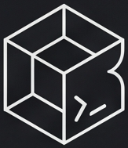

<div align="center">

<picture>
  <source media="(prefers-color-scheme: dark)" srcset=".github/assets/logo.png" />
  <source media="(prefers-color-scheme: light)" srcset=".github/assets/logo-dark.png" />
  
</picture>

# BlendOps

**Agent skills that let people who do not know Blender plan, build, check, and hand off 3D work.**

[](./LICENSE)
[](https://www.npmjs.com/package/blendops)
[](./skills/README.md)
[](./docs/runtime-stack-strategy.md)
[](./docs/release-readiness.md)
[](./docs/release-readiness.md)

</div>

BlendOps is a content pack: `SKILL.md` skills, laws, packs, and bundles that any compatible AI agent can load. It does not run Blender itself. Your agent talks to Blender through an upstream runtime (Blender Lab MCP, the community `mcp-for-blender`, or the Blender command line), and BlendOps tells it what to plan, what to check, and what evidence to collect before it says "done".

```txt
Your idea (no Blender knowledge needed)
  → BlendOps skills: brief → done criteria → scene plan → checks → handoff
  → an upstream Blender runtime (Path 1 Lab MCP / Path 2 community / CLI fallback)
  → checked files + a plain-language status reply
```

Full documentation: [`docs/README.md`](./docs/README.md).

---

## Use in 30 seconds

### Option 1: paste one prompt into any agent

```txt
Read and follow the BlendOps AI Agent Quickstart:
https://raw.githubusercontent.com/ThanhNguyxnOrg/blendops/main/docs/ai-agent-quickstart.md

Auto-detect your environment first, then pick one mode:
- If you have project filesystem write access → Mode A: install BlendOps project-locally (skills/, laws/, packs/, target-specific entrypoint).
- If you are in a chat-only UI (Claude Desktop chat, Claude.ai, ChatGPT) with no filesystem write → Mode B: output 14 separate ZIPs from skills/*/SKILL.md (one ZIP per skill) for me to drag-drop into the Skills UI manually.
- If you cannot fetch the repo, cannot write, AND cannot output ZIPs → Mode C: ask one concise question.

Do not install Blender, configure runtime connectors, run Blender, or claim generated artifacts. Report the selected mode, files changed or ZIP filenames, runtime status, artifact status, and limitations.
```

Coding agents (Claude Code, Cursor, Codex, Cline, Windsurf, and others) take Mode A and install project-locally. Chat-only apps take Mode B and get separate ZIPs from skills/*/SKILL.md, one per skill. Details: [`docs/ai-agent-install-flow.md`](./docs/ai-agent-install-flow.md).

### Option 2: install the skills with skills.sh

```bash
npx skills add ThanhNguyxnOrg/blendops
```

The repository is [listed on skills.sh](https://www.skills.sh/ThanhNguyxnOrg/blendops). [`skills.sh.json`](./skills.sh.json) groups the 15 skills into 4 groups.

### Option 3: use the npm CLI

```bash
npx blendops --help
npx blendops doctor --project .
npx blendops install --target auto --project . --dry-run
npx blendops install --target auto --project . --write
```

Review the dry run before `--write`. The installer only changes the chosen project. It does not install Blender or set up an MCP runtime.

---

## The 15 skills

Every skill name starts with `blendops-` so they stay together when installed next to other packs. Start with `blendops-start` if you are not sure which one you need.

| Step | Skill | What it does |
|---|---|---|
| Start | [`blendops-start`](./skills/blendops-start/SKILL.md) | Picks the next step and writes plain-language status replies. |
| Start | [`blendops-brief`](./skills/blendops-brief/SKILL.md) | Turns a rough idea into a locked brief and a recipe. |
| Start | [`blendops-done-criteria`](./skills/blendops-done-criteria/SKILL.md) | Writes what "done" means, stage gates, and scope limits. |
| Plan | [`blendops-product-shot`](./skills/blendops-product-shot/SKILL.md) | Plans a single product hero shot or a product grid. |
| Plan | [`blendops-scene-plan`](./skills/blendops-scene-plan/SKILL.md) | Plans character portraits, outdoor shots, and interiors. |
| Plan | [`blendops-camera`](./skills/blendops-camera/SKILL.md) | Chooses camera, framing, resolution, and aspect ratio. |
| Plan | [`blendops-lighting-materials`](./skills/blendops-lighting-materials/SKILL.md) | Plans lights, materials, and color settings. |
| Plan | [`blendops-render-settings`](./skills/blendops-render-settings/SKILL.md) | Chooses render engine (Cycles or EEVEE) and output format. |
| Assets & web | [`blendops-assets`](./skills/blendops-assets/SKILL.md) | Finds models, textures, and HDRIs and checks their licenses. |
| Assets & web | [`blendops-glb-budget`](./skills/blendops-glb-budget/SKILL.md) | Sets size and polycount limits so a GLB loads fast on web and phones. |
| Assets & web | [`blendops-glb-web-handoff`](./skills/blendops-glb-web-handoff/SKILL.md) | Hands a GLB to a web team (Three.js / React Three Fiber). |
| Run & check | [`blendops-connect-blender`](./skills/blendops-connect-blender/SKILL.md) | Picks and checks the way your agent connects to Blender. |
| Run & check | [`blendops-build`](./skills/blendops-build/SKILL.md) | Builds the planned scene in Blender step by step: shapes, materials, lights, camera, preview, render or GLB. |
| Run & check | [`blendops-final-check`](./skills/blendops-final-check/SKILL.md) | Collects evidence and checks the work before handoff. |
| Run & check | [`blendops-fix-problems`](./skills/blendops-fix-problems/SKILL.md) | Explains and fixes broken renders, exports, and runtime errors. |

v2.0.0 merged the former 48 narrow skills into 14; `blendops-build` was added after that. Each former skill is kept as a reference file inside its new skill; the old → new map is in [`CHANGELOG.md`](./CHANGELOG.md).

---

## Runtime: how your agent reaches Blender

BlendOps supports **2 MCP execution paths + a CLI fallback appendix** ([full doc](./docs/runtime-stack-strategy.md)):

| Path | What it is | Blender version |
|---|---|---|
| **Path 1: Official Blender Lab MCP** | [Lab add-on + Lab server](https://www.blender.org/lab/mcp-server/), hosted by (a) the [Anthropic Blender Connector](https://claude.com/resources/tutorials/using-the-blender-connector-in-claude) in Claude Desktop or (b) any other MCP client you configure. | Blender 5.1+ (set by the Lab add-on) |
| **Path 2: Community `mcp-for-blender`** | A separate community add-on/server ([ahujasid/mcp-for-blender](https://github.com/ahujasid/mcp-for-blender)). | Blender 3.0+ |
| **CLI fallback (appendix)** | Direct `blender --background --python`, a first-class [Blender command-line surface](https://docs.blender.org/manual/en/latest/advanced/command_line/index.html). See the [scoped mech-prop CLI eval](./docs/evals/cli-fallback-mech-prop.md). | Any supported Blender |

> [!WARNING]
> **The Anthropic Connector is not standalone.** Step 2 of Anthropic's tutorial installs the Blender Lab MCP add-on inside Blender. The Connector is only the Claude Desktop host for Path 1, so Path 1 needs Blender 5.1+ whichever host you use.

Setup walkthrough: [`docs/external-runtime-setup.md`](./docs/external-runtime-setup.md).

---

## What is proven and what is not

| Area | Status |
|---|---|
| Skills, laws, packs, bundles, CLI, deterministic evals | Shipped and checked by CI (`npm run ci`). |
| Path 1 read-only smoke test | Pass ([record](./docs/evals/blender-connector-read-only-smoke-test.md)). |
| Path 2 | Reported working by the repo owner; no formal eval file yet. |
| CLI fallback | One scoped run ([mech-prop eval](./docs/evals/cli-fallback-mech-prop.md)). |
| Full official runtime eval | Not Run. |
| Render / export / GLB artifacts from that eval | Not Produced. |

"Not Run" and "Not Produced" describe evidence files in this repo only. They do not mean the upstream runtimes are broken. Details: [`docs/release-readiness.md`](./docs/release-readiness.md).

---

## Repository map

| Folder | Holds |
|---|---|
| [`skills/`](./skills/README.md) | The 15 canonical skills (`SKILL.md`, `contract.json`, `references/`). |
| [`laws/`](./laws/README.md) · [`packs/`](./packs/README.md) | 4 laws every skill follows, and the `product-hero-v0` pack. |
| [`registry/`](./registry/) · [`schemas/`](./schemas/) | Generated skill registry, workflow graph, catalogs, and their JSON schemas. |
| [`evals/`](./evals/) | 14 deterministic eval suites (274 cases). |
| [`bundles/`](./bundles/) | Ready-made bundles: skill package, Claude Desktop manual upload, generic project. |
| [`docs/`](./docs/README.md) | Install guides for 26 targets, runtime setup, eval evidence, architecture. |
| [`bin/`](./bin/) · [`scripts/`](./scripts/) | The `blendops` CLI and the build / check scripts behind `npm run ci`. |

Contributing: read [`AGENTS.md`](./AGENTS.md) and run `npm run ci` before opening a PR.

---

## What it does not do

BlendOps does not install Blender, ship its own runtime, set up the Anthropic Connector or the Lab MCP add-on for you, run Blender, claim render/export artifacts without evidence, or claim an official marketplace/plugin listing. npm and skills.sh deliver content and the CLI only.

## License

MIT. See [`LICENSE`](./LICENSE).
